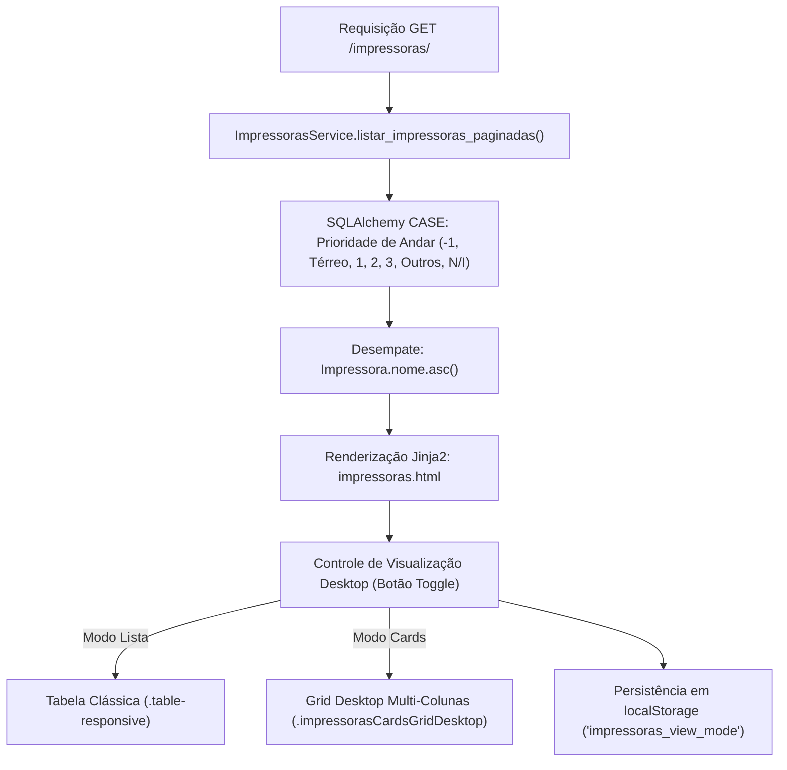

# Plano de Implementação — Alternância Lista/Cards no Desktop e Ordenação por Andar

> **Demanda**: Implementar botão de alternância entre visualização em Lista (Tabela) e Cards na versão Desktop da tela de Impressoras (`templates/impressoras/impressoras.html`), mantendo os cards modernos aprovados no mobile, e ordenar as impressoras de forma hierárquica por andar (-1 / Subsolo, Térreo, 1º Andar, 2º Andar, 3º Andar, Outras Unidades e Não Informados).
> **Data**: 2026-11-11  
> **Diretório**: `00-anything/03 - alternancia lista cards e ordenacao andar impressoras 2026-11-11/`  
> **Branch Alvo**: `feature/view-cards-impressoras-ordenacao-andar`  
> **Conformidade com AGENTS.md**: Regras 1 (Histórico no AGENTS.md), 2 (Branch dedicada + Conventional Commits), 3 (Decomposição em Issues + Linear MCP + Modo Copiável), 4 (Isolamento em `00-anything/`), 5 (Stack Real: Flask/Jinja2/SQLite/Waitress), 6 (Sincronização Graphify).

---

## 1. Contexto & Diagnóstico Atual

1. **Visualização Atual**:
   - No **Desktop** (≥ 992px), o sistema exibe exclusivamente a tabela HTML (`.table-responsive.d-none.d-lg-block`).
   - No **Mobile** (< 992px), o sistema exibe exclusivamente a lista vertical de cards (`.d-lg-none.impressorasCardsMobile`).
   - O usuário elogiou fortemente o formato card do mobile e solicitou a capacidade de escolher, também no desktop, entre a visualização clássica em lista/tabela e a visualização em cards, através de um botão de alternância (toggle).

2. **Grid de Cards para Desktop**:
   - No mobile, os cards ocupam 100% da largura em uma coluna única vertical.
   - No desktop, colocar uma única coluna vertical seria subutilizar o monitor. Portanto, a visualização em cards no desktop deve adotar um **grid responsivo multi-colunas** (ex: `row row-cols-1 row-cols-md-2 row-cols-xl-3 g-3`), garantindo uma experiência moderna de dashboard/painel de controle.

3. **Persistência de Estado (UX)**:
   - O usuário não deve precisar reativar a visualização toda vez que recarregar a tela, filtrar por status ou alternar entre Página 1 (Online) e Página 2 (Offline).
   - A preferência (`lista` ou `cards`) deve ser gravada no `localStorage` do navegador e restabelecida no carregamento (`DOMContentLoaded`).

4. **Ordenação por Andar**:
   - Atualmente, as impressoras são ordenadas puramente por `Impressora.nome.asc()`.
   - Os valores de `andar` cadastrados no banco contêm variações reais:
     - `1º Subsolo `, `SubSolo`, `-1`
     - `Térreo`
     - `1º Andar`, `1° Andar`, `1`
     - `2º Andar`, `2° Andar`, `2º andar`
     - `3º Andar`, `3° Andar`, `3`
     - Outras unidades/locais: `Asa Norte`, `Taguatinga`, `Braslav`, `Almox Q1`
     - `Não Informado` ou vazio `''`
   - A ordenação solicitada pelo usuário é hierárquica e decrescente/ascendente física:
     1. **-1 / Subsolo** (1º Subsolo, SubSolo, -1, SS)
     2. **Térreo** (Térreo, Terreo, 0)
     3. **1º Andar** (1º, 1°, 1)
     4. **2º Andar** (2º, 2°, 2)
     5. **3º Andar** (3º, 3°, 3)
     6. **Outras Unidades / Filiais** (Almoxarifado, Asa Norte, Taguatinga, Braslav...) ordenadas alfabeticamente
     7. **Não Informado / Vazio** (ao final)
   - Desempate secundário: `Impressora.nome.asc()`.

---

## 2. Arquitetura da Solução



---

## 3. Decomposição em Etapas (Issues do Linear)

### [SIR-84](https://linear.app/sirreinato/issue/SIR-84/featimpressoras-implementar-ordenacao-inteligente-de-impressoras-por) — `feat(impressoras): implementar ordenacao inteligente de impressoras por andar (-1, terreo, 1, 2, 3)`
* **Objetivo Funcional**: Aplicar a ordenação física por andares na consulta SQL de impressoras (Páginas 1 e 2), garantindo que os equipamentos apareçam na sequência -1 (Subsolo) → Térreo → 1º Andar → 2º Andar → 3º Andar → Unidades Externas → Não Informados.
* **Passo a Passo Técnico**:
  1. Em `services/impressoras_services.py`, construir a expressão `case()` do SQLAlchemy para atribuir pesos numéricos aos andares:
     - Peso 1: Subsolo / -1 / SS / 1º Subsolo
     - Peso 2: Térreo / Terreo / 0
     - Peso 3: 1º / 1° / 1
     - Peso 4: 2º / 2° / 2
     - Peso 5: 3º / 3° / 3
     - Peso 10: Outros andares/filiais (ex: Asa Norte, Taguatinga, Almoxarifado)
     - Peso 99: Vazio, nulo ou 'Não Informado'
  2. Aplicar ordenação composta na query: `.order_by(ordem_andar.asc(), Impressora.andar.asc(), Impressora.nome.asc())`.
  3. Atualizar também `listar_impressoras()` para manter a mesma coerência caso seja invocado em relatórios e rotinas auxiliares.
* **Critérios de Aceitação (DoD)**:
  - Ao listar as impressoras, os equipamentos do Subsolo aparecem primeiro, seguidos pelo Térreo, 1º, 2º e 3º andar.
  - Impressoras sem andar ou não informadas ficam no final da listagem.
  - Filtros de busca, tipo (física/virtual) e suprimento continuam funcionando perfeitamente em conjunto com a ordenação.

---

### [SIR-85](https://linear.app/sirreinato/issue/SIR-85/featimpressoras-criar-grid-de-cards-responsivo-para-desktop-e) — `feat(impressoras): criar grid de cards responsivo para desktop e componente de alternancia de visualizacao`
* **Objetivo Funcional**: Adicionar o seletor visual de alternância (Lista ↔ Cards) no cabeçalho do monitoramento de impressoras e criar o container de grid multi-colunas para exibição em cards no desktop.
* **Passo a Passo Técnico**:
  1. Em `templates/impressoras/impressoras.html`, na barra de navegação/abas das impressoras (ou cabeçalho do card), inserir o grupo de botões:
     ```html
     <div class="btn-group p-1 rounded-pill view-switcher-container" role="group" aria-label="Modo de Exibição">
         <button type="button" class="btn btn-sm rounded-pill px-3 py-1 fw-bold btn-view-mode active" data-view="lista" id="btnViewLista" title="Visualização em Lista (Tabela)">
             <i class="bi bi-list-ul me-1"></i> Lista
         </button>
         <button type="button" class="btn btn-sm rounded-pill px-3 py-1 fw-bold btn-view-mode" data-view="cards" id="btnViewCards" title="Visualização em Cards">
             <i class="bi bi-grid-fill me-1"></i> Cards
         </button>
     </div>
     ```
  2. Estruturar a seção de cards de modo unificado ou compartilhado:
     - Criar o container `#viewDesktopCards` com classe de grid `row row-cols-1 row-cols-md-2 row-cols-xl-3 g-3 mb-4` para desktop.
     - Reaproveitar os mesmos cards ricos (badges de toner e cilindro, barras de progresso, IP clicável, localização com destaque para o andar, botões Editar e Retirar Insumo).
  3. Em `static/css/global.css`, adicionar as classes para estilizar o switcher de visualização e ajustar o espaçamento dos cards em grid desktop.
* **Critérios de Aceitação (DoD)**:
  - Botão de alternância visível e alinhado com o design system do Hub Central.
  - No modo cards em desktop, os itens são exibidos em grid organizado de 2 a 3 colunas (conforme a resolução da tela).
  - Todos os modais de Editar/Vincular e Retirar Insumo continuam funcionando sem conflito de IDs.

---

### [SIR-86](https://linear.app/sirreinato/issue/SIR-86/featimpressoras-adicionar-persistencia-de-visualizacao-via) — `feat(impressoras): adicionar persistencia de visualizacao via localStorage e transicao suave`
* **Objetivo Funcional**: Permitir alternar instantaneamente entre Tabela e Cards no desktop via JavaScript, persistindo a escolha no `localStorage` do navegador para que filtros, buscas e navegação entre páginas 1 e 2 mantenham o modo escolhido.
* **Passo a Passo Técnico**:
  1. Em `templates/impressoras/impressoras.html` (no bloco de scripts), implementar a lógica:
     - Ler `localStorage.getItem('hub_impressoras_view_mode') || 'lista'`.
     - Função `setImpressorasViewMode(mode)` que alterna as classes `d-none` / ativas da tabela e do grid de cards, e atualiza os botões do switcher.
     - Event listeners nos botões `#btnViewLista` e `#btnViewCards`.
  2. Garantir comportamento responsivo:
     - No mobile (< 992px), o layout continua exibindo os cards por padrão para melhor experiência touch.
     - No desktop (≥ 992px), o toggle respeita o valor salvo no `localStorage`.
* **Critérios de Aceitação (DoD)**:
  - Clicar em "Cards" exibe imediatamente os cards no desktop e oculta a tabela sem recarregar a página.
  - Clicar em "Lista" exibe imediatamente a tabela e oculta os cards.
  - Ao recarregar a página ou submeter um filtro de busca, a visualização escolhida é lembrada e restaurada automaticamente.

---

### [SIR-87](https://linear.app/sirreinato/issue/SIR-87/docsimpressoras-atualizar-agentsmd-registrar-historico-de-alteracoes-e) — `docs(impressoras): atualizar AGENTS.md, registrar historico de alteracoes e sincronizar graphify`
* **Objetivo Funcional**: Manter a governança do repositório rigorosamente atualizada conforme as Regras 1 e 6 do `AGENTS.md`.
* **Passo a Passo Técnico**:
  1. Documentar em `AGENTS.md` as novas capacidades da tela de impressoras (ordenação por andar e modo cards desktop com persistência local).
  2. Adicionar uma nova linha na tabela de Histórico de Alterações de `AGENTS.md`.
  3. Executar o script `python scripts/atualizar_graphify.py` para atualizar a AST e os artefatos em `graphify-out/`.
  4. Realizar o push da branch dedicada para o GitHub.
* **Critérios de Aceitação (DoD)**:
  - `AGENTS.md` devidamente atualizado com histórico assinado na data de hoje.
  - `graphify` atualizado sem erros.
  - Branch pronta para PR.

---

## 4. Bloco Copiável para Agentes Sem Linear MCP

```text
================================================================================
PLANO DE EXECUÇÃO: ALTERNÂNCIA LISTA/CARDS NO DESKTOP E ORDENAÇÃO POR ANDAR
================================================================================

[CONTEXTO]
O Hub Central possui na tela de impressoras (templates/impressoras/impressoras.html)
uma tabela no desktop e cards modernos no mobile. O objetivo é permitir que o operador
no desktop escolha entre Lista (Tabela) e Cards através de um botão toggle moderno com
persistência em localStorage, além de ordenar as impressoras por andar físico na ordem:
-1 (Subsolo) -> Térreo -> 1º Andar -> 2º Andar -> 3º Andar -> Outros -> Não Informados.

[BRANCH GIT OBRIGATÓRIA]
git checkout -b feature/view-cards-impressoras-ordenacao-andar

[ETAPAS DE EXECUÇÃO]

1. ETAPA 1: feat(impressoras): implementar ordenacao inteligente de impressoras por andar (-1, terreo, 1, 2, 3)
   - Arquivo: services/impressoras_services.py
   - Implementar ordenação case() no SQLAlchemy com pesos:
     * Peso 1: Subsolo / -1 / SS / 1º Subsolo
     * Peso 2: Térreo / Terreo / 0
     * Peso 3: 1º / 1° / 1
     * Peso 4: 2º / 2° / 2
     * Peso 5: 3º / 3° / 3
     * Peso 10: Outros andares/filiais (Asa Norte, Taguatinga, etc.)
     * Peso 99: Não Informado ou Vazio
     * Desempate secundário: Impressora.nome.asc()
   - Aplicar em listar_impressoras_paginadas() e listar_impressoras().

2. ETAPA 2: feat(impressoras): criar grid de cards responsivo para desktop e componente de alternancia de visualizacao
   - Arquivos: templates/impressoras/impressoras.html, static/css/global.css
   - Inserir botão de alternância (btn-group Lista / Cards) no cabeçalho ou barra de abas.
   - Criar container de grid desktop (row row-cols-1 row-cols-md-2 row-cols-xl-3 g-3) reutilizando o design dos cards móveis.
   - Adicionar estilos em global.css para o switcher e o grid desktop.

3. ETAPA 3: feat(impressoras): adicionar persistencia de visualizacao via localStorage e transicao suave
   - Arquivos: templates/impressoras/impressoras.html
   - Criar script JS que alterna a visibilidade entre tabela e cards sem refresh.
   - Persistir em localStorage.setItem('hub_impressoras_view_mode', mode).
   - Restaurar preferência no DOMContentLoaded.

4. ETAPA 4: docs(impressoras): atualizar AGENTS.md, registrar historico de alteracoes e sincronizar graphify
   - Arquivo: AGENTS.md, scripts/atualizar_graphify.py
   - Atualizar AGENTS.md na seção de impressoras e registrar no histórico.
   - Executar python scripts/atualizar_graphify.py.
   - Git push origin feature/view-cards-impressoras-ordenacao-andar.
================================================================================
```
