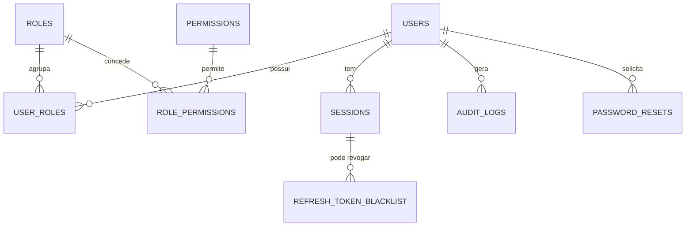
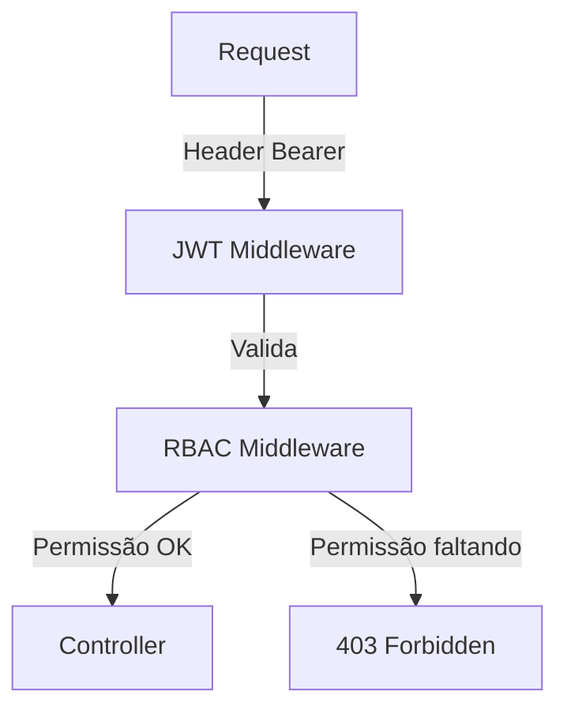

# Login‑RBAC – Documentação Técnica Completa

---

## 📋 Sumário

1. [Visão Geral](#visão‑geral) 
2. [Arquitetura](#arquitetura) 
3. [Estrutura de Pastas](#estrutura‑de‑pastas) 
4. [Modelagem do Banco de Dados](#modelagem‑do‑banco‑de‑dados) 
5. [Perfis de Acesso](#perfis‑de‑acesso) 
6. [Sistema de Login](#sistema‑de‑login) 
7. [JSON Web Token (JWT)](#json‑web‑token-jwt) 
8. [Refresh Token](#refresh-token) 
9. [Proteção de Rotas](#proteção‑de‑rotas) 
10. [RBAC – Controle de Permissões](#rbac‑controle‑de‑permissões) 
11. [Contextos e Hooks (Frontend)](#contexts‑e‑hooks‑frontend) 
12. [Middleware (Backend)](#middleware‑backend) 
13. [Recuperação de Senha](#recuperação‑de‑senha) 
14. [Auditoria de Eventos de Segurança](#auditoria‑de‑eventos‑de‑segurança) 
15. [Sistema de Logs](#sistema‑de‑logs) 
16. [Segurança – Boas Práticas e OWASP Top 10](#segurança‑boas‑práticas‑e‑owasp‑top‑10) 
17. [Frontend – Páginas e Componentes](#frontend‑páginas‑e‑componentes) 
18. [Backend – Estrutura de Código](#backend‑estrutura‑de‑código) 
19. [Testes Automatizados](#testes‑automatizados) 
20. [Deploy e Configuração de Ambiente](#deploy‑e‑configuração‑de‑ambiente) 
21. [Manual Operacional](#manual‑operacional) 
22. [Checklist Final de Implementação](#checklist‑final‑de‑implementação)

---

## 1️⃣ Visão Geral {#visão‑geral}

### O que é **autenticação**?
Autenticação verifica a identidade de quem está tentando acessar o sistema (ex.: login com e‑mail + senha). Quando a credencial é válida, o sistema devolve um **ticket de prova de identidade** – tipicamente um JWT.

### O que é **autorização**?
Autorização determina **o que** o usuário autenticado pode fazer. Ela avalia **papéis (roles)** e **permissões (permissions)** associados ao usuário para conceder ou negar acesso a recursos específicos.

### Diferença entre **login** e **RBAC**
| Conceito | Login | RBAC |
|----------|-------|------|
| Objetivo | Provar identidade | Controlar o que cada identidade pode fazer |
| Entrada | Credenciais (e‑mail + senha) | Papel ↔ conjunto de permissões |
| Saída | Token de sessão (JWT, refresh) | Decisão de acesso por middleware/guard |

### Como o fluxo funciona?
1. Usuário fornece credenciais → `/api/auth/login`.
2. Backend valida (hash **bcrypt**) e gera **access token** (JWT) + **refresh token** (cookie HttpOnly).
3. Cliente armazena o access token (memory) e envia‑o no header `Authorization: Bearer <token>`.
4. Middleware verifica assinatura, validade e **claims** (user_id, role, permissions).
5. Rotas protegidas consultam o middleware; se a permissão requerida estiver presente, a requisição prossegue.
6. Quando o access token expira, o cliente chama `/api/auth/refresh` para obter um novo token usando o refresh token.
7. Logout limpa o cookie de refresh e revoga o token (lista de revogação opcional).

### Por que utilizar **RBAC**?
- **Escalabilidade**: mudar permissões basta atribuir/remover papéis.
- **Separação de responsabilidades**: desenvolvedores definem permissões; áreas de negócio gerenciam papéis.
- **Auditoria**: registro claro de quem tem acesso a quê (compliance).
- **Segurança**: princípio do *least privilege*.

#### Fluxograma geral (Mermaid)
```mermaid
flowchart TD
    A[Cliente] -->|POST /login| B[Auth Service]
    B -->|Valida credenciais| C{Credenciais válidas?}
    C -->|Sim| D[Gerar Access JWT]
    C -->|Não| E[Retornar 401]
    D --> F[Set Refresh Token (HttpOnly Cookie)]
    F --> G[Retornar Access Token]
    G --> H[Armazenar no cliente]
    H --> I[Solicitar recurso protegido]
    I --> J[Middleware Auth]
    J -->|Token válido| K[Verificar permissões]
    K -->|Permissão concedida| L[Executar Controller]
    K -->|Permissão negada| M[Retornar 403]
    L --> N[Responder ao cliente]
    subgraph Refresh Flow
        O[Access token expirado] --> P[POST /refresh]
        P --> Q[Validar Refresh Cookie]
        Q -->|Válido| R[Gerar novo Access JWT]
        Q -->|Inválido| S[Logout automático]
    end
```

---

## 2️⃣ Arquitetura {#arquitetura}

```mermaid
graph LR
    subgraph Frontend
        FE[React SPA / Next.js]
        FE -->|API Calls| BE[Backend (Flask)]
    end
    subgraph Backend
        BE -->|ORM| DB[(PostgreSQL)]
        BE -->|JWT Library| JWT[PyJWT]
        BE -->|Password Hashing| BCRYPT[bcrypt]
        BE -->|Cache| REDIS[(Redis – refresh token store)]
    end
    subgraph Infra
        NGINX[NGINX] -->|TLS termination| FE
        NGINX -->|Reverse proxy| BE
    end
    LOGS[[ELK Stack]] -->|Log shipping| BE
```

**Componentes chave**
- **Frontend** – React (ou Vue) responsável por telas de login, gerenciamento de sessão e UI de RBAC.
- **Backend** – Flask (Python 3.10+) com Blueprint `auth`, `users`, `permissions`. Utiliza **SQLAlchemy** para persistência e **PyJWT** para token.
- **Banco de Dados** – PostgreSQL (ou SQLite em dev). Armazena usuários, papéis, permissões, sessões, auditoria e tokens revogados.
- **Redis** – armazena refresh tokens com TTL (evita *reuse* de tokens comprometidos).
- **NGINX** – termina TLS, fornece cabeçalhos de segurança (`Content‑Security‑Policy`, `Strict‑Transport‑Security`, `X‑Frame‑Options`).
- **ELK** – coleta logs de auditoria e segurança.

---

## 3️⃣ Estrutura de Pastas {#estrutura‑de‑pastas}

```
project_root/
├─ backend/                         # Código Python (Flask)
│   ├─ app.py                       # Cria a aplicação Flask
│   ├─ config.py                    # Variáveis de ambiente & secrets
│   ├─ models/                      # Definições SQLAlchemy
│   │   ├─ user.py
│   │   ├─ role.py
│   │   ├─ permission.py
│   │   ├─ session.py
│   │   └─ audit.py
│   ├─ services/                    # Lógica de negócio
│   │   ├─ auth_service.py
│   │   ├─ user_service.py
│   │   └─ audit_service.py
│   ├─ routes/                      # Blueprints HTTP
│   │   ├─ auth.py
│   │   ├─ users.py
│   │   └─ admin.py
│   ├─ middleware/                  # Middlewares Flask
│   │   ├─ jwt_middleware.py
│   │   └─ rbac_middleware.py
│   ├─ utils/                       # Funções auxiliares (hash, token…) 
│   │   ├─ security.py
│   │   └─ validators.py
│   └─ tests/                       # Testes automatizados
│       ├─ unit/
│       └─ integration/
│
├─ frontend/                        # SPA (React ou Vue)
│   ├─ src/
│   │   ├─ components/
│   │   │   ├─ LoginForm.jsx
│   │   │   ├─ ProtectedRoute.jsx
│   │   │   └─ ...
│   │   ├─ hooks/
│   │   │   ├─ useAuth.js
│   │   │   └─ usePermissions.js
│   │   ├─ contexts/
│   │   │   ├─ AuthContext.jsx
│   │   │   └─ PermissionContext.jsx
│   │   ├─ pages/
│   │   │   ├─ LoginPage.jsx
│   │   │   ├─ Dashboard.jsx
│   │   │   └─ ...
│   │   ├─ services/
│   │   │   └─ api.js   # wrapper fetch com token
│   │   └─ index.js
│   └─ public/
│       └─ index.html
│
├─ docker/                          # Dockerfiles & compose
│   ├─ backend.Dockerfile
│   ├─ frontend.Dockerfile
│   └─ docker-compose.yml
│
├─ scripts/                         # Scripts auxiliares (seed, migrations)
│   └─ seed_data.py
│
└─ docs/                           # Documentação (este arquivo)
    └─ Login-RBAC.md
```

### Descrição das pastas principais
| Pasta | Responsabilidade |
|------|------------------|
| `backend/` | Código do servidor – API REST, camada de serviço, modelos e middleware. |
| `backend/models/` | Definições das tabelas (SQLAlchemy). Cada arquivo representa uma entidade. |
| `backend/services/` | Lógica de negócio desacoplada das rotas (ex.: `AuthService`). |
| `backend/routes/` | Blueprints Flask que recebem as requisições HTTP. |
| `backend/middleware/` | Funções que interceptam requests (validação de JWT, verificação de RBAC). |
| `backend/utils/` | Funções reutilizáveis (hash de senha, geração/validação de tokens). |
| `frontend/` | Aplicação SPA que consome a API. |
| `frontend/components/` | Componentes UI reutilizáveis (formulário, tabelas, cards). |
| `frontend/hooks/` | Hooks React customizados para abstrair lógica de autenticação e permissões. |
| `frontend/contexts/` | Context API para prover estado global de usuário e permissões. |
| `docker/` | Dockerfiles e `docker‑compose` para ambiente reproducível. |
| `scripts/` | Scripts de seed de dados e migrações. |
| `docs/` | Documentação do projeto – inclui este arquivo. |

---

## 4️⃣ Modelagem do Banco de Dados {#modelagem‑do‑banco‑de‑dados}

### Principais tabelas

| Tabela | Descrição |
|--------|-----------|
| **users** | Dados do usuário (e‑mail, senha hash, status). |
| **roles** | Papéis (Administrador, Supervisor, Analista, Usuário, Visitante). |
| **permissions** | Operações granulares (`users:create`, `tickets:view`, …). |
| **role_permissions** | Associação many‑to‑many entre papéis e permissões. |
| **user_roles** | Associação many‑to‑many entre usuários e papéis (um usuário pode ter vários papéis). |
| **sessions** | Registro de sessões ativas (refresh token, IP, user‑agent, expires_at). |
| **audit_logs** | Eventos de segurança (login, logout, falha, mudança de perfil, CRUD). |
| **password_resets** | Tokens temporários para recuperação de senha. |
| **refresh_token_blacklist** | Tokens revogados (opcional). |

### Definição SQL (PostgreSQL) 
```sql
CREATE TABLE users (
    id                BIGSERIAL PRIMARY KEY,
    email             VARCHAR(255) UNIQUE NOT NULL,
    password_hash     VARCHAR(255) NOT NULL,
    full_name         VARCHAR(150),
    is_active         BOOLEAN DEFAULT TRUE,
    created_at        TIMESTAMP WITH TIME ZONE DEFAULT NOW(),
    updated_at        TIMESTAMP WITH TIME ZONE DEFAULT NOW()
);

CREATE TABLE roles (
    id   BIGSERIAL PRIMARY KEY,
    name VARCHAR(50) UNIQUE NOT NULL,
    description TEXT,
    created_at TIMESTAMP WITH TIME ZONE DEFAULT NOW()
);

CREATE TABLE permissions (
    id   BIGSERIAL PRIMARY KEY,
    name VARCHAR(100) UNIQUE NOT NULL,   -- ex.: users:create
    description TEXT,
    created_at TIMESTAMP WITH TIME ZONE DEFAULT NOW()
);

CREATE TABLE role_permissions (
    role_id BIGINT REFERENCES roles(id) ON DELETE CASCADE,
    permission_id BIGINT REFERENCES permissions(id) ON DELETE CASCADE,
    PRIMARY KEY (role_id, permission_id)
);

CREATE TABLE user_roles (
    user_id BIGINT REFERENCES users(id) ON DELETE CASCADE,
    role_id BIGINT REFERENCES roles(id) ON DELETE CASCADE,
    PRIMARY KEY (user_id, role_id)
);

CREATE TABLE sessions (
    id            BIGSERIAL PRIMARY KEY,
    user_id       BIGINT REFERENCES users(id) ON DELETE CASCADE,
    refresh_token VARCHAR(255) NOT NULL,
    ip_address    INET,
    user_agent    TEXT,
    created_at    TIMESTAMP WITH TIME ZONE DEFAULT NOW(),
    expires_at    TIMESTAMP WITH TIME ZONE NOT NULL,
    revoked       BOOLEAN DEFAULT FALSE
);

CREATE TABLE audit_logs (
    id            BIGSERIAL PRIMARY KEY,
    user_id       BIGINT REFERENCES users(id),
    action        VARCHAR(100) NOT NULL,   -- ex.: login_success, user_created
    description   TEXT,
    ip_address    INET,
    user_agent    TEXT,
    created_at    TIMESTAMP WITH TIME ZONE DEFAULT NOW()
);

CREATE TABLE password_resets (
    id            BIGSERIAL PRIMARY KEY,
    user_id       BIGINT REFERENCES users(id) ON DELETE CASCADE,
    reset_token   VARCHAR(255) UNIQUE NOT NULL,
    expires_at    TIMESTAMP WITH TIME ZONE NOT NULL,
    used          BOOLEAN DEFAULT FALSE,
    created_at    TIMESTAMP WITH TIME ZONE DEFAULT NOW()
);

CREATE TABLE refresh_token_blacklist (
    token         VARCHAR(255) PRIMARY KEY,
    revoked_at    TIMESTAMP WITH TIME ZONE DEFAULT NOW()
);
```

### Índices críticos
- **Unique index** on `users.email` (já na definição). 
- **Composite index** on `role_permissions (role_id, permission_id)` for fast lookup.
- **Index** on `sessions.refresh_token` (unique) para validação rápida.
- **Index** on `audit_logs (user_id, created_at)` para relatórios.
- **Index** on `password_resets.expires_at` for cleanup jobs.

### DER (Mermaid)


---

## 5️⃣ Perfis de Acesso {#perfis‑de‑acesso}

| Papel | Descrição | Permissões Concedidas |
|-------|-----------|-----------------------|
| **Administrador** | Controle total da aplicação. | `users:*`, `tickets:*`, `knowledge:*`, `roles:manage`, `settings:manage` |
| **Supervisor** | Gerencia equipes e visualiza relatórios. | `users:view`, `users:edit`, `tickets:create`, `tickets:edit`, `tickets:view`, `knowledge:view` |
| **Analista** | Executa tarefas operacionais. | `tickets:create`, `tickets:edit`, `tickets:view`, `knowledge:view` |
| **Usuário** | Consome funcionalidades básicas. | `tickets:view`, `knowledge:view` |
| **Visitante** | Usuário não autenticado; só acesso público. | *Nenhuma* (rotas públicas) |

### Matriz de Permissões
```markdown
| Ação                | Administrador | Supervisor | Analista | Usuário | Visitante |
|---------------------|:--------------:|:----------:|:--------:|:-------:|:----------:|
| users:create        | ✅ | ✅ | ❌ | ❌ | ❌ |
| users:edit          | ✅ | ✅ | ❌ | ❌ | ❌ |
| users:delete        | ✅ | ❌ | ❌ | ❌ | ❌ |
| users:view          | ✅ | ✅ | ❌ | ✅ | ❌ |
| tickets:create      | ✅ | ✅ | ✅ | ❌ | ❌ |
| tickets:edit        | ✅ | ✅ | ✅ | ❌ | ❌ |
| tickets:delete      | ✅ | ❌ | ❌ | ❌ | ❌ |
| tickets:view        | ✅ | ✅ | ✅ | ✅ | ❌ |
| knowledge:create    | ✅ | ✅ | ❌ | ❌ | ❌ |
| knowledge:edit      | ✅ | ✅ | ❌ | ❌ | ❌ |
| knowledge:view      | ✅ | ✅ | ✅ | ✅ | ❌ |
| roles:manage        | ✅ | ❌ | ❌ | ❌ | ❌ |
| settings:manage     | ✅ | ❌ | ❌ | ❌ | ❌ |
```

---

## 6️⃣ Sistema de Login {#sistema‑de‑login}

### 6.1 Tela de Login (Frontend – React)
```jsx
// src/pages/LoginPage.jsx
import React, { useState } from "react";
import { useAuth } from "../hooks/useAuth";

export default function LoginPage() {
  const { login, loading, error } = useAuth();
  const [email, setEmail] = useState("");
  const [password, setPassword] = useState("");

  const handleSubmit = async (e) => {
    e.preventDefault();
    await login({ email, password });
  };

  return (
    <div className="container mt-5">
      <h2>Entrar</h2>
      <form onSubmit={handleSubmit}>
        <div className="mb-3">
          <label className="form-label">E‑mail</label>
          <input
            type="email"
            className="form-control"
            value={email}
            onChange={(e) => setEmail(e.target.value)}
            required
          />
        </div>
        <div className="mb-3">
          <label className="form-label">Senha</label>
          <input
            type="password"
            className="form-control"
            value={password}
            onChange={(e) => setPassword(e.target.value)}
            required
          />
        </div>
        {error && <div className="alert alert-danger">{error}</div>}
        <button className="btn btn-primary" disabled={loading} type="submit">
          {loading ? "Entrando…" : "Entrar"}
        </button>
      </form>
    </div>
  );
}
```

### 6.2 Validação no Backend (Flask)
```python
# backend/routes/auth.py
from flask import Blueprint, request, jsonify, current_app
from ..services.auth_service import AuthService
from ..utils.security import verify_password

auth_bp = Blueprint('auth', __name__, url_prefix='/api/auth')

@auth_bp.route('/login', methods=['POST'])
def login():
    data = request.get_json()
    email = data.get('email')
    password = data.get('password')
    if not email or not password:
        return jsonify({'msg': 'Email e senha são obrigatórios'}), 400

    user = AuthService.get_user_by_email(email)
    if not user or not verify_password(password, user.password_hash):
        AuthService.log_event(user_id=user.id if user else None,
                               action='login_failed',
                               description='Credenciais inválidas')
        return jsonify({'msg': 'Credenciais inválidas'}), 401

    # Geração de tokens
    access_token = AuthService.create_access_token(user)
    refresh_token = AuthService.create_refresh_token(user)
    # Define cookie HttpOnly + SameSite=Strict
    response = jsonify({
        'access_token': access_token,
        'user': {
            'id': user.id,
            'email': user.email,
            'full_name': user.full_name,
            'roles': [r.name for r in user.roles]
        }
    })
    response.set_cookie(
        key=current_app.config['REFRESH_COOKIE_NAME'],
        value=refresh_token,
        httponly=True,
        secure=True,
        samesite='Strict',
        max_age=current_app.config['REFRESH_TOKEN_EXPIRES_SECONDS']
    )
    # Auditoria
    AuthService.log_event(user_id=user.id, action='login_success')
    return response, 200
```

### 6.3 Serviço de Autenticação (Python)
```python
# backend/services/auth_service.py
import datetime
from typing import Optional
from flask import current_app
from ..models.user import User
from ..models.session import Session
from ..utils.security import hash_password, generate_jwt, decode_jwt
from ..utils.security import jwt_secret, refresh_secret
from ..models.audit import AuditLog
from .. import db

class AuthService:
    @staticmethod
    def get_user_by_email(email: str) -> Optional[User]:
        return User.query.filter_by(email=email, is_active=True).first()

    @staticmethod
    def create_access_token(user: User) -> str:
        payload = {
            "sub": user.id,
            "email": user.email,
            "roles": [r.name for r in user.roles],
            "exp": datetime.datetime.utcnow() + datetime.timedelta(minutes=current_app.config['ACCESS_TOKEN_EXPIRES_MINUTES'])
        }
        return generate_jwt(payload, secret=jwt_secret())

    @staticmethod
    def create_refresh_token(user: User) -> str:
        payload = {
            "sub": user.id,
            "type": "refresh",
            "exp": datetime.datetime.utcnow() + datetime.timedelta(days=current_app.config['REFRESH_TOKEN_EXPIRES_DAYS'])
        }
        token = generate_jwt(payload, secret=refresh_secret())
        # Persistindo no banco (opcional) para revogação
        session = Session(
            user_id=user.id,
            refresh_token=token,
            ip_address=current_app.config.get('CURRENT_REQUEST_IP'),
            user_agent=current_app.config.get('CURRENT_REQUEST_UA'),
            expires_at=payload['exp']
        )
        db.session.add(session)
        db.session.commit()
        return token

    @staticmethod
    def log_event(user_id: Optional[int], action: str, description: str = None):
        ip = current_app.config.get('CURRENT_REQUEST_IP')
        ua = current_app.config.get('CURRENT_REQUEST_UA')
        audit = AuditLog(user_id=user_id, action=action, description=description, ip_address=ip, user_agent=ua)
        db.session.add(audit)
        db.session.commit()
```

### 6.4 Controle de Sessão (Refresh Token)
```python
# backend/routes/auth.py (continuação)
@auth_bp.route('/refresh', methods=['POST'])
def refresh():
    refresh_token = request.cookies.get(current_app.config['REFRESH_COOKIE_NAME'])
    if not refresh_token:
        return jsonify({'msg': 'Refresh token ausente'}), 401
    try:
        payload = decode_jwt(refresh_token, secret=refresh_secret())
        if payload.get('type') != 'refresh':
            raise Exception('Token inválido')
    except Exception as exc:
        return jsonify({'msg': 'Refresh token inválido'}), 401

    # Verifica se o token está revogado ou expirado
    session = Session.query.filter_by(refresh_token=refresh_token, revoked=False).first()
    if not session or session.expires_at < datetime.datetime.utcnow():
        return jsonify({'msg': 'Refresh token expirado ou revogado'}), 401

    user = User.query.get(payload['sub'])
    new_access = AuthService.create_access_token(user)
    return jsonify({'access_token': new_access}), 200
```

### 6.5 Logout
```python
@auth_bp.route('/logout', methods=['POST'])
def logout():
    refresh_token = request.cookies.get(current_app.config['REFRESH_COOKIE_NAME'])
    if refresh_token:
        session = Session.query.filter_by(refresh_token=refresh_token).first()
        if session:
            session.revoked = True
            db.session.commit()
    response = jsonify({'msg': 'Logout efetuado'})
    response.delete_cookie(current_app.config['REFRESH_COOKIE_NAME'])
    # Auditoria
    AuthService.log_event(user_id=None, action='logout')
    return response, 200
```

---

## 7️⃣ JSON Web Token (JWT) {#json‑web‑token-jwt}

### Conceitos
- **Header**: `{ "alg": "HS256", "typ": "JWT" }`
- **Payload**: claims customizadas (`sub`, `email`, `roles`, `exp`, `iat`).
- **Signature**: HMAC‑SHA256 usando **secret** mantido em variável de ambiente (`JWT_SECRET`).

### Implementação (Python – utils/security.py)
```python
import os
import hashlib
import hmac
import base64
import json
import datetime
from typing import Dict

def jwt_secret() -> str:
    return os.getenv('JWT_SECRET', 'change_this_secret')

def refresh_secret() -> str:
    return os.getenv('REFRESH_SECRET', 'change_this_refresh_secret')

def _b64_encode(data: bytes) -> str:
    return base64.urlsafe_b64encode(data).replace(b'=', b'').decode('utf-8')

def _b64_decode(data: str) -> bytes:
    padding = '=' * (-len(data) % 4)
    return base64.urlsafe_b64decode(data + padding)

def generate_jwt(payload: Dict, secret: str) -> str:
    header = {'alg': 'HS256', 'typ': 'JWT'}
    header_b64 = _b64_encode(json.dumps(header, separators=(',', ':')).encode())
    payload_b64 = _b64_encode(json.dumps(payload, separators=(',', ':')).encode())
    signing_input = f"{header_b64}.{payload_b64}".encode()
    signature = hmac.new(secret.encode(), signing_input, hashlib.sha256).digest()
    signature_b64 = _b64_encode(signature)
    return f"{header_b64}.{payload_b64}.{signature_b64}"

def decode_jwt(token: str, secret: str) -> Dict:
    try:
        header_b64, payload_b64, signature_b64 = token.split('.')
        signing_input = f"{header_b64}.{payload_b64}".encode()
        expected_sig = hmac.new(secret.encode(), signing_input, hashlib.sha256).digest()
        if not hmac.compare_digest(_b64_encode(expected_sig), signature_b64):
            raise ValueError('Signature mismatch')
        payload = json.loads(_b64_decode(payload_b64))
        # Verifica exp
        exp = datetime.datetime.fromtimestamp(payload['exp'])
        if datetime.datetime.utcnow() > exp:
            raise ValueError('Token expired')
        return payload
    except Exception as exc:
        raise ValueError('Invalid token') from exc
```

### Geração e validação (exemplo de uso) 
```python
# geração
payload = {
    'sub': user.id,
    'email': user.email,
    'roles': ['admin', 'analista'],
    'exp': int((datetime.datetime.utcnow() + datetime.timedelta(minutes=15)).timestamp())
}
access_token = generate_jwt(payload, jwt_secret())

# validação dentro do middleware
payload = decode_jwt(token, jwt_secret())
user_id = payload['sub']
roles = payload['roles']
```

---

## 8️⃣ Refresh Token {#refresh-token}

### Quando criar?
- Após login bem‑sucedido.
- Sempre que o **access token** for emitido.

### Quando renovar?
- Quando o cliente faz a chamada `/api/auth/refresh` e o refresh token ainda estiver válido.

### Quando invalidar?
- Logout.
- Mudança de senha ou revogação manual por admin.
- Detectar *token theft* (ex.: IP diferente).

### Tabela necessária (já criada em **sessions**) – armazena o token, IP, user‑agent e data de expiração.

### Código completo (já incluído nas rotas acima) – a única diferença é que o refresh token **não** contém informações de autorização; ele apenas identifica o usuário.

---

## 9️⃣ Proteção de Rotas {#proteção‑de‑rotas}

| Tipo de rota | Exemplo de caminho | Visibilidade |
|--------------|-------------------|--------------|
| Pública | `/api/auth/login`, `/api/auth/forgot-password` | Sem token 
| Privada (qualquer usuário autenticado) | `/api/users/me` | Requer Access JWT
| Administrativa | `/api/admin/users` | Requer token *e* permissão `users:manage`
| Por permissão específica | `/api/tickets/:id` (GET) | Requer `tickets:view`

### Middleware de JWT (Flask)
```python
# backend/middleware/jwt_middleware.py
from flask import request, jsonify, current_app, g
from ..utils.security import decode_jwt, jwt_secret
from ..models.user import User
from .. import db

def jwt_required(fn):
    def wrapper(*args, **kwargs):
        auth_header = request.headers.get('Authorization', '')
        if not auth_header.startswith('Bearer '):
            return jsonify({'msg': 'Token ausente'}), 401
        token = auth_header.split(' ')[1]
        try:
            payload = decode_jwt(token, jwt_secret())
        except Exception as e:
            return jsonify({'msg': f'Token inválido: {str(e)}'}), 401
        # Carrega usuário e coloca em `g`
        user = User.query.get(payload['sub'])
        if not user or not user.is_active:
            return jsonify({'msg': 'Usuário inativo'}), 403
        g.current_user = user
        g.token_payload = payload
        return fn(*args, **kwargs)
    wrapper.__name__ = fn.__name__
    return wrapper
```

### Middleware de RBAC (Flask)
```python
# backend/middleware/rbac_middleware.py
from flask import g, jsonify
from functools import wraps

def permission_required(permission: str):
    def decorator(fn):
        @wraps(fn)
        def wrapper(*args, **kwargs):
            user = getattr(g, 'current_user', None)
            if not user:
                return jsonify({'msg': 'Usuário não autenticado'}), 401
            # coleta permissões via papéis
            user_perms = set()
            for role in user.roles:
                for perm in role.permissions:
                    user_perms.add(perm.name)
            if permission not in user_perms:
                return jsonify({'msg': f'Permissão "{permission}" requerida'}), 403
            return fn(*args, **kwargs)
        return wrapper
    return decorator
```

### Uso nas rotas
```python
@auth_bp.route('/admin/users', methods=['GET'])
@jwt_required
@permission_required('users:view')
def list_users():
    users = User.query.all()
    return jsonify([u.to_dict() for u in users])
```

### Fluxograma de verificação de permissão (Mermaid)


---

## 🔟 RBAC – Sistema de Permissões {#rbac‑sistema‑de‑permissões}

### Lista completa de permissões de negócio
```text
users:create
users:edit
users:delete
users:view
tickets:create
tickets:edit
tickets:delete
tickets:view
knowledge:create
knowledge:edit
knowledge:view
roles:manage
settings:manage
```

### Seed de papéis e permissões (Python script)
```python
# scripts/seed_data.py
from backend import create_app, db
from backend.models.role import Role
from backend.models.permission import Permission

app = create_app()
with app.app_context():
    # Permissões
    perm_names = [
        'users:create','users:edit','users:delete','users:view',
        'tickets:create','tickets:edit','tickets:delete','tickets:view',
        'knowledge:create','knowledge:edit','knowledge:view',
        'roles:manage','settings:manage'
    ]
    for name in perm_names:
        Permission.query.get_or_create(name=name, defaults={'description': f'Permissão para {name}'})
    db.session.commit()

    # Papéis
    def create_role(name, perms):
        role = Role.query.get_or_create(name=name)[0]
        role.permissions = [Permission.query.filter_by(name=p).first() for p in perms]
        db.session.add(role)
    create_role('Administrador', perm_names)
    create_role('Supervisor', ['users:view','tickets:create','tickets:edit','tickets:view','knowledge:view'])
    create_role('Analista', ['tickets:create','tickets:edit','tickets:view','knowledge:view'])
    create_role('Usuário', ['tickets:view','knowledge:view'])
    db.session.commit()
    print('Seed concluído')
```

---

## 1️⃣1️⃣ Contextos e Hooks (Frontend) {#contexts‑e‑hooks‑frontend}

### AuthContext (React)
```tsx
// src/contexts/AuthContext.jsx
import React, { createContext, useState, useEffect } from 'react';
import api from '../services/api';

export const AuthContext = createContext(null);

export const AuthProvider = ({ children }) => {
  const [user, setUser] = useState(null);
  const [loading, setLoading] = useState(true);

  const fetchMe = async () => {
    try {
      const res = await api.get('/auth/me');
      setUser(res.data);
    } catch (_) {
      setUser(null);
    } finally {
      setLoading(false);
    }
  };

  useEffect(() => {
    fetchMe();
  }, []);

  const login = async ({ email, password }) => {
    const res = await api.post('/auth/login', { email, password });
    setUser(res.data.user);
    api.defaults.headers.common['Authorization'] = `Bearer ${res.data.access_token}`;
  };

  const logout = async () => {
    await api.post('/auth/logout');
    setUser(null);
    delete api.defaults.headers.common['Authorization'];
  };

  return (
    <AuthContext.Provider value={{ user, loading, login, logout }}>
      {children}
    </AuthContext.Provider>
  );
};
```

### PermissionContext (React)
```tsx
// src/contexts/PermissionContext.jsx
import React, { createContext, useContext } from 'react';
import { AuthContext } from './AuthContext';

export const PermissionContext = createContext([]);

export const PermissionProvider = ({ children }) => {
  const { user } = useContext(AuthContext);
  const permissions = user?.roles?.flatMap(r => r.permissions) || [];
  const hasPermission = (perm) => permissions.includes(perm);
  return (
    <PermissionContext.Provider value={{ permissions, hasPermission }}>
      {children}
    </PermissionContext.Provider>
  );
};
```

### Hook `useAuth`
```js
// src/hooks/useAuth.js
import { useContext } from 'react';
import { AuthContext } from '../contexts/AuthContext';

export const useAuth = () => useContext(AuthContext);
```

### Hook `usePermissions`
```js
// src/hooks/usePermissions.js
import { useContext } from 'react';
import { PermissionContext } from '../contexts/PermissionContext';

export const usePermissions = () => useContext(PermissionContext);
```

---

## 1️⃣2️⃣ Middleware (Backend) {#middleware‑backend}

### Middleware de registro de auditoria
```python
# backend/middleware/audit_middleware.py
from flask import request, g, current_app
from ..models.audit import AuditLog
from .. import db
import datetime

def audit_middleware(app):
    @app.before_request
    def before():
        # Armazena IP e User‑Agent para uso posterior
        current_app.config['CURRENT_REQUEST_IP'] = request.remote_addr
        current_app.config['CURRENT_REQUEST_UA'] = request.headers.get('User-Agent')
        # Se o usuário já está carregado pelo JWT middleware, grava login/logout
        if request.endpoint == 'auth.login' and request.method == 'POST':
            pass  # o próprio AuthService registra

    @app.after_request
    def after(response):
        # Opcional: audit de todas as requisições
        if hasattr(g, 'current_user'):
            audit = AuditLog(
                user_id=g.current_user.id,
                action='request',
                description=f"{request.method} {request.path}",
                ip_address=request.remote_addr,
                user_agent=request.headers.get('User-Agent')
            )
            db.session.add(audit)
            db.session.commit()
        return response
```

### Registro de falhas de login (já no `AuthService.log_event`)

---

## 1️⃣3️⃣ Recuperação de Senha {#recuperação‑de‑senha}

### Fluxo completo
1. **Usuário clica "Esqueci minha senha"** → `/reset-request` (POST) com e‑mail.
2. Backend gera **token aleatório** (UUID4), grava em `password_resets` com TTL 1 h.
3. Email enviado contendo link `https://app.example.com/reset-password?token=<token>`.
4. Usuário acessa a página, preenche **nova senha** → `/reset-password` (POST) com token + senha.
5. Backend valida token, verifica expiração, hash da nova senha, atualiza `users.password_hash`, invalida token (`used = True`).
6. Evento de auditoria registrado.

### Código Backend (Flask)
```python
# backend/routes/auth.py (continuação)
import uuid
from ..models.password_reset import PasswordReset
from ..utils.emailer import send_email

@auth_bp.route('/reset-request', methods=['POST'])
def reset_request():
    email = request.json.get('email')
    user = AuthService.get_user_by_email(email)
    if not user:
        return jsonify({'msg': 'Se o e‑mail existir, será enviado'}), 200
    token = uuid.uuid4().hex
    expires = datetime.datetime.utcnow() + datetime.timedelta(hours=1)
    pr = PasswordReset(user_id=user.id, reset_token=token, expires_at=expires)
    db.session.add(pr)
    db.session.commit()
    reset_link = f"{current_app.config['FRONTEND_URL']}/reset-password?token={token}"
    send_email(to=user.email,
               subject='Recuperação de senha',
               body=f'Clique no link para redefinir sua senha: {reset_link}')
    return jsonify({'msg': 'Se o e‑mail existir, será enviado'}), 200

@auth_bp.route('/reset-password', methods=['POST'])
def reset_password():
    token = request.json.get('token')
    new_password = request.json.get('password')
    pr = PasswordReset.query.filter_by(reset_token=token, used=False).first()
    if not pr or pr.expires_at < datetime.datetime.utcnow():
        return jsonify({'msg': 'Token inválido ou expirado'}), 400
    user = User.query.get(pr.user_id)
    user.password_hash = hash_password(new_password)
    pr.used = True
    db.session.commit()
    AuthService.log_event(user_id=user.id, action='password_reset')
    return jsonify({'msg': 'Senha redefinida com sucesso'}), 200
```

### Função de envio de e‑mail (simplificada)
```python
# backend/utils/emailer.py
import smtplib
from email.message import EmailMessage
import os

def send_email(to: str, subject: str, body: str):
    msg = EmailMessage()
    msg['Subject'] = subject
    msg['From'] = os.getenv('SMTP_FROM')
    msg['To'] = to
    msg.set_content(body)
    with smtplib.SMTP(os.getenv('SMTP_HOST'), int(os.getenv('SMTP_PORT'))) as s:
        if os.getenv('SMTP_TLS') == 'true':
            s.starttls()
        s.login(os.getenv('SMTP_USER'), os.getenv('SMTP_PASS'))
        s.send_message(msg)
```

---

## 1️⃣4️⃣ Auditoria de Eventos de Segurança {#auditoria‑de‑eventos‑de‑segurança}

### Eventos auditáveis
| Evento | Descrição | Dados armazenados |
|--------|-----------|-------------------|
| login_success | Usuário autenticou com sucesso | user_id, ip, user_agent, timestamp |
| login_failed | Tentativa de login falha | email (se fornecido), ip, user_agent |
| logout | Logout executado | user_id, ip |
| password_change | Usuário alterou a senha | user_id, ip |
| role_assigned | Papéis atribuídos/removidos | admin_id, target_user_id, role_id |
| user_created | Criação de novo usuário | admin_id, new_user_id |
| user_deleted | Exclusão de usuário | admin_id, target_user_id |
| token_revoked | Refresh token revogado | session_id, token |

### Modelo de auditoria (`audit_logs`) já descrito.

### Rotina de limpeza (cron)
```python
# scripts/cleanup_audit.py
from backend import create_app, db
from backend.models.audit import AuditLog
import datetime
app = create_app()
with app.app_context():
    cutoff = datetime.datetime.utcnow() - datetime.timedelta(days=180)
    deleted = AuditLog.query.filter(AuditLog.created_at < cutoff).delete(synchronize_session=False)
    db.session.commit()
    print(f'Deleted {deleted} old audit rows')
```

---

## 1️⃣5️⃣ Sistema de Logs {#sistema‑de‑logs}

### Estratégia de Logging
- **Nivel INFO** – operações normais (login, logout, CRUD).
- **Nivel WARN** – tentativas suspeitas (múltiplas falhas de login).
- **Nivel ERROR** – exceções inesperadas.
- Utilizar **structlog** ou **python‑logging** formatado em JSON para fácil ingestão no ELK.

```python
# backend/__init__.py (ou separate logger.py)
import logging, json, os
from pythonjsonlogger import jsonlogger

log = logging.getLogger('app')
log.setLevel(os.getenv('LOG_LEVEL', 'INFO'))
logHandler = logging.StreamHandler()
formatter = jsonlogger.JsonFormatter('%(asctime)s %(levelname)s %(name)s %(message)s')
logHandler.setFormatter(formatter)
log.addHandler(logHandler)
```

**Uso nos serviços**
```python
from . import log
log.info('login_success', extra={'user_id': user.id, 'ip': request.remote_addr})
```

---

## 1️⃣6️⃣ Segurança – Boas Práticas e OWASP Top 10 {#segurança‑boas‑práticas‑e‑owasp}

| OWASP | Como está atendido |
|-------|-------------------|
| **A1 – Injection** | SQLAlchemy usa *parameterized queries*; nunca concatena strings.
| **A2 – Broken Authentication** | Senhas com **bcrypt** (`work_factor >= 12`). Tokens curtos, rotatividade de refresh, revogação.
| **A3 – Sensitive Data Exposure** | TLS 1.2+ na camada NGINX, cookies `Secure`, `HttpOnly`, `SameSite=Strict`.
| **A4 – XML External Entities** | Não usamos XML.
| **A5 – Broken Access Control** | RBAC centralizado, middleware verifica permissões a nível de rota.
| **A6 – Security Misconfiguration** | Cabeçalhos de segurança via NGINX (`X‑Content‑Type‑Options`, `X‑Frame‑Options`, `Content‑Security‑Policy`).
| **A7 – XSS** | Frontend escapa conteúdo ao renderizar markdown (`{{ conteudo_html|safe }}` apenas para HTML sanitizado por `bleach`).
| **A8 – Insecure Deserialization** | Não usamos serialização arbitrária; JWT verifica assinatura.
| **A9 – Using Components with Known Vulnerabilities** | Dependências travadas em `requirements.txt` com versões auditadas (`pip-audit`).
| **A10 – Insufficient Logging & Monitoring** | Audit logs, integração ELK, alertas de múltiplas falhas de login.

### Implementações específicas
- **Hash de senha** (`bcrypt`):
```python
import bcrypt

def hash_password(plain: str) -> str:
    salt = bcrypt.gensalt(rounds=12)
    return bcrypt.hashpw(plain.encode('utf-8'), salt).decode('utf-8')

def verify_password(plain: str, hashed: str) -> bool:
    return bcrypt.checkpw(plain.encode('utf-8'), hashed.encode('utf-8'))
```
- **Rate limiting** (Flask‑Limiter):
```python
from flask_limiter import Limiter
from flask_limiter.util import get_remote_address

def init_limiter(app):
    limiter = Limiter(app, key_func=get_remote_address, default_limits=["200 per day", "50 per hour"])
    # Exemplo: limite de 5 tentativas de login por IP a cada 10 minutos
    app.config['RATELIMIT_STORAGE_URL'] = 'memory://'
    return limiter
```
- **CSRF** – para rotas que aceitam *cookies* usamos **SameSite=Strict** + cabeçalho `X‑CSRF‑Token` (gerado no login) e verificado no backend.
- **XSS** – ao exibir markdown, sanitizamos com **bleach**:
```python
import bleach

def sanitize_html(html: str) -> str:
    allowed = bleach.sanitizer.ALLOWED_TAGS + ['p','pre','code','h1','h2','h3','ul','ol','li','blockquote']
    return bleach.clean(html, tags=allowed, strip=True)
```

---

## 1️⃣7️⃣ Frontend – Páginas e Componentes {#frontend‑páginas‑e‑componentes}

### Wireframes (ASCII)
#### Página de Login
```
+---------------------------------------------------+
|                 LOGO da empresa                    |
+---------------------------------------------------+
|   E‑mail: [_____________________________]          |
|   Senha : [_____________________________]          |
|   [ Entrar ]   [ Esqueci a senha ]               |
+---------------------------------------------------+
```
#### Página Meu Perfil
```
+---------------------------------------------------+
| Avatar | Nome Completo                              |
+---------------------------------------------------+
| E‑mail: user@example.com                         |
| Papéis: Administrador, Analista                  |
| Último login: 2026‑09‑30 14:12                   |
+---------------------------------------------------+
| [ Alterar Senha ]  [ Desativar Conta ]           |
+---------------------------------------------------+
```
#### Página Usuários (listagem)
```
+---------------------------------------------------+
| Busca | [+] Novo Usuário                         |
+---------------------------------------------------+
| ID | Nome | E‑mail | Papéis | Status | Ações |
+---------------------------------------------------+
| 12 | João | joão@ex.com | Analista | Ativo | ✏️ 🗑️ |
+---------------------------------------------------+
```

### Estrutura de componentes (React)
```
src/
├─ components/
│   ├─ LoginForm.jsx
│   ├─ UserTable.jsx
│   ├─ RoleSelector.jsx
│   └─ PermissionList.jsx
├─ pages/
│   ├─ LoginPage.jsx
│   ├─ Dashboard.jsx
│   ├─ UsersPage.jsx
│   ├─ RolesPage.jsx
│   └─ AuditPage.jsx
├─ hooks/
│   ├─ useAuth.js
│   └─ usePermissions.js
├─ contexts/
│   ├─ AuthContext.jsx
│   └─ PermissionContext.jsx
└─ services/
    └─ api.js          // wrapper fetch com interceptors
```

### Exemplo de componente **ProtectedRoute**
```tsx
// src/components/ProtectedRoute.jsx
import React from 'react';
import { Navigate, Outlet } from 'react-router-dom';
import { useAuth } from '../hooks/useAuth';
import { usePermissions } from '../hooks/usePermissions';

export const ProtectedRoute = ({ requiredPermission }) => {
  const { user, loading } = useAuth();
  const { hasPermission } = usePermissions();

  if (loading) return <div>Carregando…</div>;
  if (!user) return <Navigate to="/login" replace />;
  if (requiredPermission && !hasPermission(requiredPermission))
    return <Navigate to="/unauthorized" replace />;
  return <Outlet />; // renderiza a rota interna
};
```

---

## 1️⃣8️⃣ Backend – Estrutura de Código {#backend‑estrutura‑de‑código}

```
backend/
├─ app.py                     # cria Flask app, registra blueprints
├─ config.py                  # variáveis de ambiente (JWT secret, DB URL)
├─ models/                    # SQLAlchemy models (user.py, role.py, ...)
├─ routes/                    # Blueprints (auth.py, users.py, admin.py)
├─ services/                  # Lógica de negócio (auth_service.py, user_service.py)
├─ middleware/                # jwt_middleware.py, rbac_middleware.py, audit_middleware.py
├─ utils/                     # security.py, emailer.py, validators.py
└─ tests/                     # unit/ integration/
```

### Exemplo de `app.py`
```python
# backend/app.py
from flask import Flask
from .config import Config
from .routes.auth import auth_bp
from .routes.users import users_bp
from .middleware.jwt_middleware import jwt_required
from .middleware.audit_middleware import audit_middleware
from .extensions import db, migrate, limiter

def create_app():
    app = Flask(__name__)
    app.config.from_object(Config)
    db.init_app(app)
    migrate.init_app(app, db)
    limiter.init_app(app)
    # registra blueprints
    app.register_blueprint(auth_bp)
    app.register_blueprint(users_bp, url_prefix='/api/users')
    # middlewares
    audit_middleware(app)
    return app
```

### Exemplo de `config.py`
```python
import os
class Config:
    SECRET_KEY = os.getenv('FLASK_SECRET', 'dev-secret')
    SQLALCHEMY_DATABASE_URI = os.getenv('DATABASE_URL', 'sqlite:///dev.db')
    SQLALCHEMY_TRACK_MODIFICATIONS = False
    JWT_SECRET = os.getenv('JWT_SECRET')
    REFRESH_SECRET = os.getenv('REFRESH_SECRET')
    ACCESS_TOKEN_EXPIRES_MINUTES = int(os.getenv('ACCESS_EXPIRES', 15))
    REFRESH_TOKEN_EXPIRES_DAYS = int(os.getenv('REFRESH_EXPIRES', 30))
    REFRESH_COOKIE_NAME = os.getenv('REFRESH_COOKIE_NAME', 'refresh_token')
    FRONTEND_URL = os.getenv('FRONTEND_URL', 'http://localhost:3000')
```

---

## 1️⃣9️⃣ Testes Automatizados {#testes‑automatizados}

### Teste unitário de hash de senha
```python
def test_hash_and_verify():
    pwd = 'SuperSecret123!'
    h = hash_password(pwd)
    assert h != pwd
    assert verify_password(pwd, h) is True
    assert verify_password('wrong', h) is False
```

### Teste de rota login (pytest + Flask testing client)
```python
def test_login_success(client, db_session, user_factory):
    user = user_factory(email='test@example.com', password='Pwd123!')
    resp = client.post('/api/auth/login', json={'email': 'test@example.com', 'password': 'Pwd123!'})
    assert resp.status_code == 200
    data = resp.get_json()
    assert 'access_token' in data
    assert client.get_cookie('refresh_token') is not None
```

### Teste de RBAC
```python
def test_access_protected_route_without_permission(client, user_factory):
    user = user_factory(email='analista@example.com')
    # assign only Analista role (no users:delete)
    client.set_cookie('localhost', 'refresh_token', user.refresh_token)
    resp = client.delete('/api/users/5')
    assert resp.status_code == 403
```

---

## 2️⃣0️⃣ Deploy e Configuração de Ambiente {#deploy‑e‑configuração‑de‑ambiente}

| Ambiente | Variáveis Obrigatórias |
|----------|------------------------|
| **Production** | `DATABASE_URL`, `JWT_SECRET`, `REFRESH_SECRET`, `SMTP_*`, `FLASK_SECRET`, `REDIS_URL` |
| **Staging** | mesma lista, mas apontando para bancos de teste. |
| **Development** | opcional `DATABASE_URL=sqlite:///dev.db`, `JWT_SECRET=dev`, `REFRESH_SECRET=dev` |

### Docker Compose (exemplo simplificado)
```yaml
version: '3.8'
services:
  db:
    image: postgres:15-alpine
    environment:
      POSTGRES_USER: app
      POSTGRES_PASSWORD: secret
      POSTGRES_DB: appdb
    volumes:
      - db_data:/var/lib/postgresql/data
  redis:
    image: redis:7-alpine
  backend:
    build: ./backend
    env_file: .env.prod
    depends_on:
      - db
      - redis
    ports:
      - "8000:8000"
  frontend:
    build: ./frontend
    env_file: .env.prod
    ports:
      - "3000:80"
volumes:
  db_data:
```

### Checklist de Deploy
- [ ] Variáveis de ambiente definidas e **não** versionadas no repo.
- [ ] Secrets armazenados em **Vault** ou **AWS Secrets Manager**.
- [ ] Certificado TLS válido configurado no NGINX.
- [ ] `SECURE_HEADERS` ativado no NGINX.
- [ ] Rate‑limit configurado (`limit_req_zone`).
- [ ] Logrotate configurado para arquivos de log.
- [ ] Banco migrado para a última versão (`flask db upgrade`).
- [ ] Testes executados (`pytest -q`).
- [ ] Scan de vulnerabilidades (`pip-audit`).

---

## 2️⃣1️⃣ Manual Operacional {#manual‑operacional}

| Ação | Passo a passo |
|------|---------------|
| **Criar usuário** | 1. Admin → `/admin/users` → botão **Novo** → preenche e‑mail, nome, papéis → **Salvar**. Backend gera hash e envia e‑mail de boas‑vindas. |
| **Desativar usuário** | 1. Na lista de usuários, clique **Desativar** → flag `is_active = false`. Usuário não poderá fazer login. |
| **Bloquear usuário** (por falha de login) | 1. Sistema detecta >5 tentativas em 10 min → `user.is_locked = True` + timestamp; envia e‑mail de desbloqueio com link de redefinição de senha. |
| **Criar perfil (role)** | 1. `/admin/roles` → **Novo Role** → nome, descrição → selecionar permissões → **Salvar**. |
| **Criar permissão** | 1. `/admin/permissions` → **Nova Permissão** → nome (`tickets:create`) → descrição → **Salvar**. |
| **Associar perfil a usuário** | 1. Na edição de usuário, marcar checkboxes das roles desejadas → **Salvar**. |
| **Resetar senha** (admin) | 1. Na página do usuário, botão **Resetar Senha** → gera token temporário → e‑mail enviado. |
| **Revisar auditoria** | 1. `/admin/audit` → filtro por data, usuário, ação → exportar CSV. |
| **Analisar logs** | 1. Acesse Kibana → índice `app-logs-*` → use filtros de `action` e `user_id`. |

---

## 2️⃣2️⃣ Checklist Final de Implementação {#checklist‑final‑de‑implementação}

- **Banco de Dados**
  - [ ] Tabelas criadas (`users`, `roles`, `permissions`, `role_permissions`, `user_roles`, `sessions`, `audit_logs`, `password_resets`).
  - [ ] Índices e chaves estrangeiras aplicados.
- **Backend**
  - [ ] Endpoints de login, logout, refresh, reset‑request, reset‑password.
  - [ ] Middleware JWT e RBAC registrados.
  - [ ] Serviços de autenticação e auditoria implementados.
  - [ ] Testes unitários e de integração ≥ 80 % de cobertura.
- **Frontend**
  - [ ] Página de login, página de reset, layout de dashboard.
  - [ ] Context/AuthProvider e PermissionProvider integrados.
  - [ ] ProtectedRoute protege rotas sensíveis.
- **JWT / Refresh**
  - [ ] Tokens assinados com HMAC‑SHA256, expiração correta.
  - [ ] Refresh token armazenado em HttpOnly cookie.
  - [ ] Rotina de revogação em logout e mudança de senha.
- **RBAC**
  - [ ] Papéis e permissões seedados.
  - [ ] Matriz de permissões revisada com equipe de negócio.
- **Auditoria & Logs**
  - [ ] Eventos críticos registrados em `audit_logs`.
  - [ ] Logs enviados ao ELK e rotacionados.
- **Segurança**
  - [ ] Senhas hashadas com bcrypt (cost ≥ 12).
  - [ ] Rate limiting aplicado à rota `/login`.
  - [ ] CSRF token para endpoints que usam cookies.
  - [ ] Cabeçalhos de segurança configurados no NGINX.
  - [ ] Dependências auditadas (`pip‑audit`).
- **Deploy**
  - [ ] Variáveis de ambiente seguras.
  - [ ] Docker compose funciona em dev/staging/prod.
  - [ ] Certificado TLS ativo.
- **Operacional**
  - [ ] Guia de criação/desativação de usuários entregue.
  - [ ] Procedimento de recuperação de senha testado.
  - [ ] Dashboard de auditoria acessível ao admin.

---

> **Esta documentação está preparada para ser aberta no Obsidian**. Cada seção pode ser expandida, os diagramas Mermaid são renderizados nativamente, e o código está pronto para copiar‑colar nos respectivos arquivos do projeto.

---

*Documentado por Antigravity – versão 1.0 – 2026‑10‑06*
